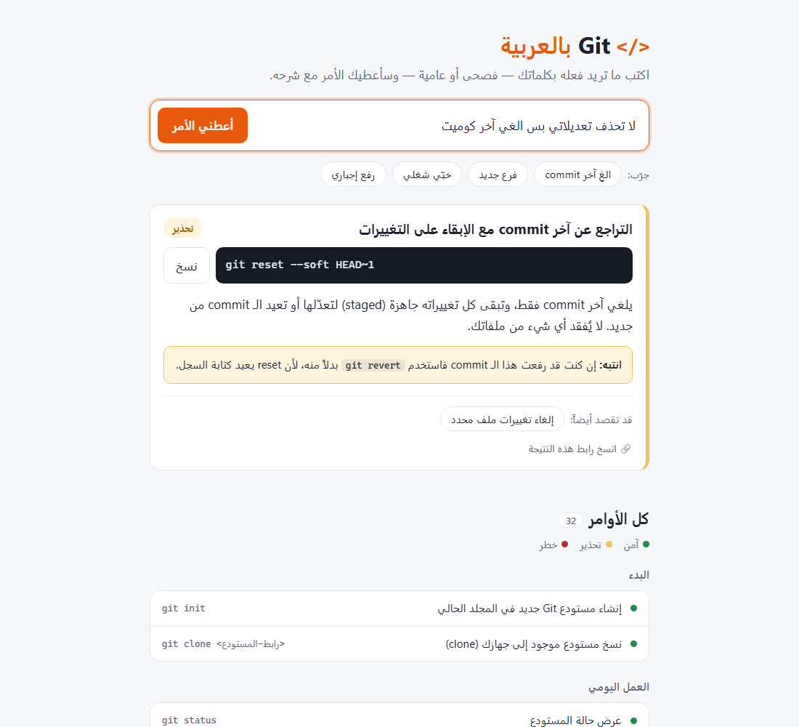

# Git بالعربية

اكتب بالعربية — فصحى أو عامية — ما تريد فعله في Git، فتحصل على الأمر الصحيح مع شرح مختصر ومستوى خطورته (آمن / تحذير / خطر).



> الأداة **تعرض** الأوامر فقط ولا تنفّذ أي شيء على جهازك.

## المزايا

- **32 أمراً** في 7 فئات: البدء، العمل اليومي، الفروع، الحفظ المؤقت، التراجع والإصلاح، المستودع البعيد، التنظيف.
- يفهم **الفصحى واللهجات** (خليجي، مصري، شامي...) والكلمات الإنجليزية الممزوجة: «ابغى ارجع آخر كوميت بس خلي التعديلات».
- يفهم **النفي**: «لا تحذف تعديلاتي» و«بدون ما يروح الكود» تعني الإبقاء على التغييرات، لا حذفها.
- **تحذير أحمر واضح** للأوامر الخطرة (`reset --hard`، `push --force`، `clean -fd`...). وعند الشك بين أمرين يختار الأكثر أماناً.
- **يملأ القيم تلقائياً**: «اعمل فرع اسمه feature-login» تعطي `git switch -c feature-login`، والروابط والرسائل بين علامتي تنصيص تُملأ كذلك.
- **روابط قابلة للمشاركة**: كل نتيجة لها رابط (`?q=...` أو `?id=...`).
- قائمة بكل الأوامر، ووضع داكن، وتصميم متجاوب مع الجوال، واضغط <kbd>/</kbd> للبحث.
- **بلا أي مكتبات**: HTML وCSS وJavaScript فقط.

## التشغيل محلياً

الصفحة تقرأ `commands.json` عبر `fetch`، لذلك تحتاج خادماً محلياً بسيطاً (فتح `index.html` بنقرة مزدوجة لن يعمل في أغلب المتصفحات):

```bash
python -m http.server 8000
```

ثم افتح: http://localhost:8000

## الاختبارات

```bash
node tests.js
```

| المجموعة | العدد | ماذا تقيس |
|---|---|---|
| الأساسية | 30 | جمل بصيغ فصحى ولهجات مختلفة |
| الموسّعة | 31 | المهام المضافة وصيغ النفي |
| العمياء | 30 | جمل كُتبت **قبل** ضبط الكلمات المفتاحية عليها؛ أول قياس لها كان 23/30 (77%) |
| خارج الموضوع | 4 | جمل لا علاقة لها بـ Git يجب ألا تطابق شيئاً |

يتحقق أيضاً من سلامة `commands.json` (الحقول، تكرار المعرّفات، وأن كل أمر خطير معلَّم كـ `danger` وله تحذير)، ويطبع الجمل التي لم تُفهم. يخرج برمز `1` إن فشل أي شيء.

> ملاحظة صادقة: كل المجموعات تنجح الآن لأن الكلمات المفتاحية ضُبطت عليها. الرقم الأقرب للواقع مع جمل لم يرها النظام هو نتيجة القياس الأعمى الأول (≈77%).

## النشر

المشروع ملفات ثابتة فقط، فيعمل على أي استضافة ثابتة.

### GitHub Pages (مجاني)

1. أنشئ مستودعاً جديداً على GitHub (مثلاً `git-arabic`).
2. ارفع الملفات:
   ```bash
   git init
   git add .
   git commit -m "Git بالعربية"
   git branch -M main
   git remote add origin https://github.com/<اسم-المستخدم>/git-arabic.git
   git push -u origin main
   ```
3. في المستودع: **Settings → Pages → Source: Deploy from a branch → main / (root)**.
4. بعد دقيقة يصبح الموقع على `https://<اسم-المستخدم>.github.io/git-arabic/`.

### Netlify (بلا Git)

اسحب المجلد كاملاً وأفلته في https://app.netlify.com/drop.

### بعد النشر: معاينة الرابط في LinkedIn

LinkedIn يحتاج روابط كاملة لصورة المعاينة. في `index.html` عدّل السطرين:

```html
<meta property="og:image" content="https://<اسم-المستخدم>.github.io/git-arabic/og-image.png">
<meta property="og:url" content="https://<اسم-المستخدم>.github.io/git-arabic/">
```

ثم افحص الرابط في https://www.linkedin.com/post-inspector/ قبل نشره (يحدّث المعاينة المخزّنة أيضاً).

## هيكل المشروع

| الملف | الدور |
|---|---|
| `index.html` | الصفحة (RTL) ووسوم المعاينة |
| `style.css` | التصميم: متجاوب، ووضع داكن |
| `app.js` | منطق الفهم والعرض |
| `commands.json` | قاعدة الأوامر وقاموس المترادفات والفئات |
| `tests.js` | الاختبارات |
| `og-image.png` | صورة معاينة الرابط (1200×627) |
| `social/` | مصدر صورة المعاينة ولقطات الشاشة للمنشور |

## كيف يفهم الطلب؟

1. **التطبيع** (`normalizeArabic`): إزالة التشكيل والتطويل، وتوحيد `أ إ آ ← ا`، `ى ← ي`، `ة ← ه`، `ؤ ← و`، `ئ ← ي`، وحذف الرموز.
2. **التقطيع ونزع السوابق**: كل كلمة تُجرَّب بعد نزع `ال، وال، بال، لل، و، ف، ب، ل`، مع تسامح بحرفين في آخرها (`تغيير ← تغييرات`).
3. **النفي** (`applyNegation`): كلمة حذف أو ضياع تأتي بعد `لا، ما، بدون، من غير، مش، مو...` تُعامَل كـ«إبقاء».
4. **المترادفات**: كل كلمة مفتاحية تُوسَّع عبر قاموس `synonyms`، فكلمة `كوميت` تطابق أيضاً `commit` و`كومت` و`إيداع`.
5. **المطابقة** (`matchIntent`): الكلمة المفتاحية تطابق إن وُجدت **كل** كلماتها في الجملة بأي ترتيب. تحصل المهمة على نقطة لكل كلمة من جملة المستخدم غطّتها كلماتها المفتاحية، وتفوز الأعلى. عند التعادل تفوز العبارة الأطول، ثم الأكثر أماناً.
6. إن لم تطابق أي مهمة تُعرض رسالة لطيفة مع أقرب 3 اقتراحات.
7. **تعبئة القيم** (`fillPlaceholders`): الرابط ← `<رابط-المستودع>`، والنص بين تنصيص ← `<الرسالة>`، وأول اسم لاتيني ← اسم الفرع أو الملف.

## إضافة مهمة جديدة

أضف كائناً إلى مصفوفة `commands` في `commands.json`:

```json
{
  "id": "tag",
  "category": "remote",
  "title": "إنشاء وسم (tag) لإصدار",
  "keywords": ["انشئ وسم", "tag", "وسم اصدار"],
  "command": "git tag <اسم-الوسم>",
  "explanation": "يضع علامة باسم ثابت على الـ commit الحالي، تُستخدم عادةً لترقيم الإصدارات.",
  "danger": "safe"
}
```

| الحقل | الوصف |
|---|---|
| `id` | معرّف فريد بالإنجليزية |
| `category` | مفتاح من `categories` |
| `title` | عنوان المهمة كما يظهر للمستخدم |
| `keywords` | عبارات قصيرة؛ يجب أن تظهر **كل** كلمات العبارة في جملة المستخدم. لا تحتاج تشكيلاً ولا همزات |
| `command` | الأمر. `<...>` للقيم التي يملؤها المستخدم، و`\n` لأمرين متتاليين |
| `explanation` | شرح عربي مختصر. أي `git ...` أو `--خيار` بداخله يُعرض تلقائياً بخط برمجي |
| `danger` | `safe` أو `warning` أو `danger` |
| `warning` | إلزامي إن كان `danger`، واختياري غير ذلك |

### نصائح لكتابة الكلمات المفتاحية

- استخدم **مفاتيح** قاموس `synonyms` (مثل `احذف`، `كوميت`، `فرع`) بدلاً من تكرار كل الصيغ؛ `احذف` تشمل تلقائياً `امسح، شيل، طير، delete...`.
- لإضافة كلمة عامية لمعنى موجود، أضفها إلى مجموعتها في `synonyms` فتستفيد منها كل المهام.
- تجنّب الكلمات المفتاحية المكوّنة من كلمة عامة واحدة (مثل `ملف`).
- العبارات الأطول تميّز بين المهام المتشابهة، مثل `تراجع كوميت ابقي` و`تراجع كوميت احذف`.
- بعد الإضافة أضف جملاً إلى `tests.js` وشغّل `node tests.js`.

## إعادة توليد صورة المعاينة

صورة `og-image.png` مولّدة من `social/og.html`. مع تشغيل الخادم المحلي:

```bash
msedge --headless=new --window-size=1200,627 --screenshot=og-image.png http://localhost:8000/social/og.html
```

(يعمل الأمر نفسه مع `chrome` بدل `msedge`.)

## المكتبات الخارجية

لا يوجد. يستخدم خطوط النظام العربية (Segoe UI / Noto / Tahoma) حتى يعمل دون اتصال.
